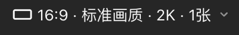
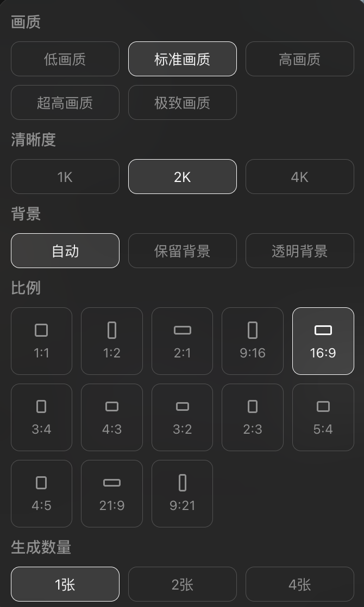

# AIGC 视频生成平台产品设计方案 V2.0

本文描述经讨论确认的目标产品设计，不表示相应功能已经实现。原型 V1.0 为独立演示版本。

## 一、定位与本期目标

面向个人创作者，基于 Toonflow 的画布、节点、模型接入及素材复用能力，闭合以下主流程：

**新建项目 → 文字／图片／视频／音频节点创作 → 媒体进入个人资产 → 收藏内容 → 跨节点、跨项目引用 → 撤销与恢复。**

采用个人本地使用模式，内容在当前安装环境中跨项目复用。不包含账号体系、云同步、企业功能、公共作品发布、轻剪辑及整张工作流自动执行。推荐模板与作品中心保留在整体规划中，本期不实施。

产品不展示积分、余额、充值或报价。用户仍需配置相应模型服务的 API Key；生成失败时明确解释供应商未配置、额度不足、参数不支持等原因，不自动跳转充值。

## 二、页面与新建项目

### 1. 项目入口

首页与“我的项目”均提供“新建项目”，使用同一个创建流程：

1. 用户填写项目名称，默认“未命名项目”。
2. 系统在应用管理的项目目录下创建独立项目，不要求用户每次选择空文件夹。
3. 创建成功后进入空白画布，项目同时出现在“我的项目”和首页最近项目中。
4. 创建失败保留名称，允许重试，不产生重复项目记录。

保留“导入本地项目”，供用户选择已有 Toonflow 项目目录。默认使用一张主画布；已有项目的其他画布可从“画布”面板切换。

项目支持打开、搜索和重命名。已有项目使用新增能力时补充所需内容，不覆盖原画布；打开失败时不得覆盖原文件。

### 2. 画布布局

| 区域 | 设计 |
|---|---|
| 顶部 | 仅项目名称，点击可重命名 |
| 左侧 | 始终显示“画布”“资产”两个入口，内容面板可收起 |
| 中央 | 无限画布，支持节点、连线、分组 |
| 右侧 | 不设置固定面板 |
| 画布工具栏 | 撤销、恢复、缩小、放大、适应画布 |

节点内部展示输入、参考素材、模型、参数与生成结果。保留自动保存；保存失败临时提示并允许重试，离开前仍未保存成功时提醒用户。

画布空白处右键提供新增文字、图片、视频、音频节点及“引用”。新增节点出现在右键位置。本期通过节点内部按钮发起生成，不提供自动运行整张工作流的入口。

### 3. 左侧“画布”与“资产”

“画布”面板展示当前项目的画布列表、切换入口与节点快捷入口。

“资产”面板直接展示两个页签，不只提供跳转按钮：

| 页签 | 内容 | 与资产库的关系 |
|---|---|---|
| 个人资产 | 图片、视频、音频 | 使用资产库中的同一份个人资产 |
| 我的收藏 | 提示词、配置、图片、视频、音频 | 使用资产库中的同一份收藏 |

支持搜索、分类和预览；收藏支持重命名、取消收藏。资产库、左侧资产面板与输入框引用面板同步更新，不重复维护三套记录。

将媒体卡片拖到画布空白处，创建对应媒体节点；拖入兼容节点参考区，添加为参考。提示词或配置应用到已有节点前展示预览，拖到空白画布时提示“请创建节点后选择”。

## 三、四类节点创作

### 1. 统一入口，复用原有能力

产品层只展示四类节点，复用 Toonflow 现有媒体展示、处理与生成能力。用户不需要在“展示节点”和“生成节点”之间选择。

| 节点 | 输入与操作 | 结果 |
|---|---|---|
| 文字 | 手写、粘贴、引用文本或模型兼容媒体；模型生成、改写 | 文案、剧本、分镜描述、提示词 |
| 图片 | 上传或引用图片，输入提示词生成；模型支持时编辑参考图片 | 图片及历史候选 |
| 视频 | 上传或引用视频、兼容参考媒体，输入提示词生成 | 视频及历史候选 |
| 音频 | 上传、引用音频；按模型能力选择配音或音乐模式 | 音频及历史候选 |

文字正文采用 Markdown 编辑能力，不新增角色、场次、镜头等结构化剧本编辑器。配音模式区分“配音正文”和“声音／表达要求”；输入框工具图标作用于声音／表达要求。

### 2. 输入框图标与悬浮提示

| 节点 | 优化提示词 | 收藏 | 引用 |
|---|---|---|---|
| 文字 | 不展示 | 保留 | 保留 |
| 图片 | 保留 | 保留 | 保留 |
| 视频 | 保留 | 保留 | 保留 |
| 音频 | 保留 | 保留 | 保留 |

鼠标悬停或键盘聚焦图标时，分别显示“优化提示词”“收藏”“引用”。不可用时同时说明原因，例如“请输入内容后收藏”。文字节点保留模型生成与改写，仅不展示输入框中的优化入口。

### 3. 输入框粘贴图片和视频

四类节点的输入框支持粘贴剪贴板中可读取的图片和视频文件：

**粘贴 → 校验类型、数量及模型能力 → 上传并收录到个人资产 → 添加到输入框上方参考区。**

- 媒体作为参考附件，不创建独立画布节点，也不转换成提示词。
- 参考区显示缩略图、名称、类型、用途、上传状态及移除按钮。
- 混合粘贴文字与媒体时，文字插入当前光标位置，媒体进入参考区。
- 多文件逐项处理并反馈；某项失败不丢弃其他成功项。
- 不支持的类型、超出数量的附件不添加，明确说明原因，已有内容保持不变。
- 普通视频网址作为文本插入，不自动下载。
- 粘贴、上传成功或添加参考均不自动生成。
- 移除参考或撤销粘贴不删除已收录的个人资产。

### 4. 生成参数摘要与面板

#### 4.1 统一参数入口

输入框下方使用一条紧凑入口汇总参数，参考用户提供的图一：

**比例示意图标　16:9 · 标准画质 · 2K · 1张　下拉箭头**

图一：用户提供的参数摘要形式示意。

比例图标随当前选择变化。点击整条摘要，弹出分区网格形式的参数面板，参考图二的分区、选中态和选项卡结构；颜色沿用平台主题。模型选择独立保留。

#### 4.2 图片节点参数面板

图二：用户提供的参数面板形式示意。分区与选中态参考该图，实际选项按模型能力展示，颜色沿用平台主题。

| 分区 | 形式与示例 |
|---|---|
| 画质 | 按钮选项：低画质、标准画质、高画质、超高画质、极致画质 |
| 清晰度 | 按钮选项：1K、2K、4K |
| 背景 | 模型支持时展示自动、保留背景、透明背景 |
| 比例 | 比例图标与文字组成的选项卡 |
| 生成数量 | 按钮选项：1张、2张、4张 |

比例选项可包含 1:1、1:2、2:1、9:16、16:9、3:4、4:3、3:2、2:3、5:4、4:5、21:9、9:21。

以上为展示形式示例。实际选项由当前模型能力决定，不展示虚假的可选能力。比例、画质与清晰度为独立参数概念。

- 点击选项立即应用，摘要同步更新；点击面板外部或按 Esc 收起。
- 参数修改不自动生成，可撤销、恢复。
- 切换模型导致原值不兼容时标记并要求重新选择，不静默替换。
- 图片背景等参数仅在模型支持时展示。

#### 4.3 其他节点适配

视频采用相同摘要和面板形式，展示模型支持的比例、清晰度、时长与生成数量，数量单位为“条”。

音频展示模型支持的声音、格式、时长与生成数量，不展示画面比例或图片画质。文字不展示图片、视频参数入口，保留文本模型配置。

新增参数保存在节点与项目中。收藏配置仍限定为模型、画面比例、参考图片和参考视频，不自动包含画质、清晰度、背景或生成数量。

### 5. 生成交互

默认选择已配置且可用的模型，没有可用模型时引导配置，不自动调用 TF-Router。开始前检查输入、参数、参考类型与数量；不兼容时阻止生成并说明原因。

生成期间显示状态，允许请求停止；停止不保证供应商已经撤销任务。失败不清空输入或已有结果，重试由用户主动触发。

成功后保留历史结果，最新成功结果默认采用，允许切换采用版本。多结果任务中，每份成功媒体均独立进入个人资产并可预览、采用、收藏。部分失败保留成功项，显示成功数量与失败原因，不自动重试。

生成开始时固定本次输入及参考快照。期间编辑节点或切换上游采用结果，不改变已提交的任务。

### 6. 优化提示词

图片、视频、音频节点使用以下流程：

**点击优化 → 弹出面板 → 输入内容与风格要求 → 生成 → 编辑优化结果 → 应用。**

打开面板时带入当前提示词。应用前不修改原文，应用后可编辑、撤销。原输入在优化期间发生变化时，应用前确认替换。未配置文本模型时提示先配置；失败保留面板内容并允许重试。

### 7. 自定义连接节点

用户自主建立、删除及重新连接节点，不要求按固定顺序编排。

- 从来源输出端拖动到目标输入端建立连接，同时保留点击来源端点、再点击目标端点的方式。
- 拖动时高亮兼容输入端，不兼容时展示原因。
- 文字输出作为下游文本参考；媒体输出按目标模型能力作为参考素材。
- 支持一对多、多对一，但须遵守目标模型支持的类型、用途和数量。
- 禁止自连接、重复连接和循环依赖。
- 连线标明内容用途；选中后可删除或重新连接。
- 删除连线同步移除该连线提供的参考，不删除媒体资产。
- 连接仅建立内容依赖，不自动执行生成。上游没有有效结果时，生成前明确提示。
- 节点支持移动、多选、复制、删除、分组与解除分组。

连接、删除、重新连接和分组均纳入编辑历史，支持撤销恢复。

## 四、个人资产与收藏

### 1. 资产库结构

资产库仅包含“个人资产”和“我的收藏”，没有企业资产。内容仅供当前个人环境使用。

个人资产按图片、视频、音频分类。本人上传成功的文件、所有成功生成的媒体结果自动收录，包括未采用候选；失败任务不产生可用资产。

媒体展示名称、预览、类型、来源项目、创建时间与具体版本。文字结果保存在项目，需要跨项目复用时可收藏为文案。

已收录的资产独立于节点和项目保留。删除节点、项目或收藏记录不连带删除其他位置保存的媒体。

“删除个人资产”将对应记录移出个人资产列表，已有项目和收藏保留所需的具体媒体版本，不提供连带删除所有引用的操作。

### 2. 收藏提示词、文案与配置

输入框非空时可以点击收藏，支持同时选择：

- 收藏提示词：保存当前文本。
- 收藏配置：多选模型、画面比例、参考图片及参考视频，保留参考用途；只展示该节点支持的字段。

同时选择时分别创建两张卡片。首版不收藏时长、音量、参考音频，以及本次新增的画质、清晰度、背景和生成数量。

AI 根据内容命名，卡片展示文本或配置摘要，允许重命名。命名失败时，文本使用前 20 个字，配置使用“节点类型＋模型名称”，不阻塞收藏使用。

文字节点结果提供“收藏文案”，归入“我的收藏—提示词”，卡片标记“文案”。引用时可以应用到输入框；文字节点还可以选择载入正文编辑区。

### 3. 收藏图片、视频、音频

用户右键具体媒体结果选择“收藏”，立即保存到对应分类，提示“已收藏，正在生成名称”。AI 分析该媒体内容并生成默认名称，用户可以重命名。

图片分析主体与场景；视频分析代表帧及可用内容；音频分析人声、音乐或环境声。分析能力不可用或失败时，使用“媒体类型＋收藏时间”。

命名不阻塞收藏及引用。用户手动命名后，后续 AI 结果不得覆盖。重复收藏同一媒体版本时提示“已收藏”，可定位并重命名。

收藏绑定具体媒体版本，切换节点采用结果不改变收藏内容。取消收藏只删除收藏记录。

## 五、统一引用与撤销恢复

### 1. 统一资产来源与引用目标

画布右键、输入框图标和左侧资产面板使用同一份资产与收藏。

| 入口 | 媒体 | 提示词与配置 |
|---|---|---|
| 画布右键引用 | 多选后按顺序创建对应媒体节点 | 不可选择，提示“请创建节点后选择” |
| 节点输入框引用 | 多选兼容媒体，添加到输入框上方参考区 | 单选后预览，再应用到当前节点 |
| 左侧资产拖动 | 拖到空白处创建节点；拖入兼容参考区添加参考 | 应用到已有节点前预览，空白处不可应用 |

同一次选择不混选媒体与提示词／配置。引用不自动生成。同一媒体版本与用途不重复添加，数量与类型按模型能力校验。

引用个人资产或收藏媒体时，将所需文件复制到目标项目。应用配置中的参考媒体时也采用同样方式，使来源项目删除或资产改名不影响已有引用。

### 2. 提示词与配置应用规则

提示词整体替换当前输入；已有内容时预览替换前后内容并确认。

配置预览中选择要应用的字段，只替换勾选项。参考图片与参考视频分别替换相应类别，未勾选项不变。先校验完整组合，再整体应用。

模型下线、素材失效或配置不兼容时标明原因，不可直接应用对应项；其余有效内容可继续选择。不得静默丢失原值或部分应用后才告知失败。

### 3. 撤销与恢复

工具栏提供“撤销”“恢复”，恢复重新执行刚撤销的编辑。支持 Cmd/Ctrl＋Z、Cmd/Ctrl＋Shift＋Z。

编辑历史覆盖：

- 节点新增、移动、复制、删除、分组与解除分组。
- 连线新增、删除及重新连接。
- 提示词、文字正文、模型与参数修改，包括参数面板选项。
- 参考素材添加、移除、替换，包括粘贴媒体带来的参考变更。
- 提示词优化应用、收藏内容应用。
- 已有媒体结果之间的采用版本切换。

连续输入合并为一次文本编辑；批量引用或整体应用配置记为一步。撤销后新增编辑清空恢复记录。每张画布当前打开期间保留最多 100 步，重新打开后重新记录。

撤销不取消已提交模型任务，不删除生成资产，不回滚已完成上传、收藏保存及模型服务设置。撤销引用或粘贴，只恢复节点及参考区编辑状态。

## 六、代码改造接口与验收

### 1. 改造边界

- 复用现有 Vue Flow、节点插件、模型供应商适配器和统一文件操作入口。
- 统一四类节点的产品入口，保留底层媒体处理与生成能力。
- 将当前文件夹素材库扩展为个人资产记录与收藏记录，不直接把文件名当作资产身份。
- 新增资产查询与收录、收藏保存与重命名、引用应用、异步命名能力。媒体使用稳定标识及版本关联，收藏配置记录节点类别与被勾选字段。
- 左侧资产、资产库及节点引用面板共用资产与收藏数据。
- 为输入框增加图片、视频粘贴处理，复用上传、个人资产收录与参考区能力。
- 按模型能力提供参数摘要与面板，不在界面中提供无效参数。
- 保留并扩展连线类型校验、自定义连接、重新连接及循环依赖检查。
- 节点编辑历史记录用户可编辑状态，与生成任务状态、资产持久化操作分离。
- 保留现有画布读取能力；新增字段采用兼容扩展，旧项目打开失败时不覆盖原文件。
- 本期不实施企业资产、积分计费、整张工作流自动执行、公共作品发布和轻剪辑。

### 2. 核心验收场景

| 场景 | 通过标准 |
|---|---|
| 两个新建入口 | 首页和我的项目进入同一创建流程，项目列表同步可见 |
| 四类节点 | 可完成手写／上传／引用及已配置模型支持的生成 |
| 输入框工具 | 文字节点没有优化入口；其他三类节点保留优化入口 |
| 图标提示 | 优化、收藏、引用图标悬停或聚焦时文字正确，不可用时说明原因 |
| 粘贴媒体 | 合法图片、视频进入个人资产与参考区，文字插入当前光标位置 |
| 粘贴边界 | 网址不自动下载；不兼容及超限附件明确提示，失败不覆盖已有内容 |
| 参数摘要 | 比例图标、摘要和面板选中项一致，点击可以打开参数面板 |
| 参数能力 | 仅提供模型支持选项，不兼容参数阻止生成，不静默替换 |
| 多结果生成 | 成功结果分别收录、预览、采用和收藏；部分失败反馈数量与原因 |
| 自定义连接 | 支持拖动及点击连接、删除、重新连接；自连接、重复和循环被阻止 |
| 连线参考 | 生成使用上游当前采用结果的快照，无有效结果时提示，不自动生成 |
| 左侧资产 | 直接展示个人资产与我的收藏，与资产库、引用面板同步 |
| 自动收录 | 上传、粘贴上传和所有成功候选进入正确分类，失败任务不产生可用资产 |
| 跨项目复用 | 项目 A 的媒体可在项目 B 创建节点或作为参考，来源项目删除后仍可使用 |
| 文本与配置收藏 | 分类、摘要和名称正确，只应用约定内容及勾选字段 |
| 收藏字段范围 | 新增参数可保存在项目中，但不自动扩大收藏配置字段 |
| AI 媒体命名 | 收藏立即成功；命名失败有默认名称，手动名称不被覆盖 |
| 引用目标 | 画布创建媒体节点，输入框添加参考；空白画布不能直接应用提示词和配置 |
| 模型不兼容 | 明确指出不兼容项，不静默丢失输入、配置或参考，不提交生成 |
| 撤销恢复 | 可恢复文本、参数、参考、采用结果与连线，不重复生成或删除资产 |
| 保存与兼容 | 保存失败保留编辑内容，旧 Toonflow 项目打开失败时不破坏原文件 |

本方案为主流程的完整设计基线。开发验证使用本地文件和可控的模型响应验证状态流转；真实模型调用单独验收，不以模拟通过代替实际图片、视频或音频生成成功。
